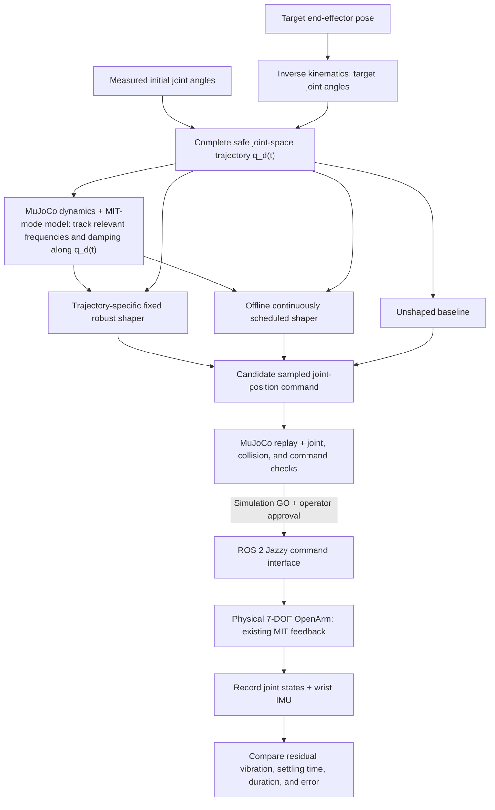

# ME 6404 Final Project

**Model-Based Vibration Suppression for a 7-DoF OpenArm Manipulator**  
Georgia Tech ME 6404 · Fall 2026

## Objective

Reduce residual vibration after OpenArm joint motions while limiting the added motion time.
Model the existing MIT-mode joint-feedback system, estimate how its oscillatory modes vary with joint configuration, and compare three commands for the same complete trajectory:

1. **Unshaped** joint-position reference (baseline).
2. **Trajectory-specific fixed shaper** designed for the frequency range encountered along that full trajectory.
3. **Offline continuously configuration-scheduled shaper** whose parameters change throughout that trajectory.

Performance measures include residual vibration, settling/total completion time, tracking error, and robustness.

Available measurements include joint angles and IMU + gyro from wrist-mounted Realsense camera.

## Planned system flow



**Scope:**
Left arm only.
Low-level MIT motor controller is not replaced (though gains can be changed).
Physical experiments require review through MuJoCo simulation first.
Only after explicit approval is given can hardware be commanded.

## Milestones and approximate timeline

| When | Milestones | Status / outcome |
| --- | --- | --- |
| **Nov 5–11** | **M0–M2:** proposal, hardware feasibility, closed-loop dynamics derivation | **Complete.** Repeatable configuration-dependent joint response observed; 14-state linear model derived. |
| **Nov 10–16** | **M3:** Python/MuJoCo modal analysis | **In progress.** Inertia, gravity, linearization, and multi-configuration eigenmode calculations implemented; full-trajectory frequency report in progress. |
| **Nov 17–23** | **M4 - M5:** compare predicted vs. measured modes; design trajectory-specific fixed shaper, validate in simulation, and test on hardware| Project update **Nov 23** with findings. |
| **Nov 24–Dec 1** | **M5:** Design configuration-scheduled shaper, validate in simulation, and test on hardware | Should be mostly done after this. |
| **Dec 2–9** | ; final analysis, presentation, report | **M6** integration if time permits|

## Software

- **Python 3.12, NumPy/SciPy, MuJoCo:** standalone dynamics, modal analysis, shaping, and simulation; **ROS 2 Jazzy** only for hardware integration.
- **MCAP** files will be used to log data.
- **MATLAB** can be used for analysis and plotting, but will not be used for simulation/hardware.

---

## M0 - Project Proposal
**Objective**: Create a project proposal to present with.

**Status:** Complete

---

## M1 - Test vibrations on the physical OpenArm
**Objective**: Determine if there is a real and measurable vibration that makes this project viable. Determine which measurement best captures it.

**Status:** Complete

---

## M2 - Derive closed-loop system model
**Objective:** Derive the closed-loop system model for the OpenArm and the low-level MIT motor controllers. 

**Status:** Complete

### OpenArm Nonlinear Dynamics

```
M(q) q_ddot + C(q, q_dot) q_dot + g(q) = tau
```

| Symbol | Physical meaning | Dimension |
| --- | --- | --- |
| q | Joint positions | 7x1 |
| M(q) | Joint space inertia matrix | 7x7 |
| C(q, q_dot) q_dot | Coriolis & centrifugal torques | 7x1 |
| g(q) | Gravitational torques | 7x1 |
| tau | Applied joint torques | 7x1 |


---

### MIT-mode joint controller

```
tau = Kp (qd - q) + Kd (qd_dot - q_dot) + tau_ff
```

Where qd_dot = 0 for constant desired configuration.

Giving the following dynamics:

```
M(q) q_ddot + C(q, q_dot) q_dot + Kd q_dot + Kp (q - qd) + g(q) = tau_ff
```

Where `Kp, Kd` are effective torque-level controller gain matrices.

---

### Equilibrium and gravity compensation

Set `q_dot = q_ddot = 0` at equilibrium.

Giving the following:

```
g(q0) + Kp (q0 - qd) = tau_ff
```
Where `tau_ff = g(qd)` to make `qd` an equilibrium

---

### Linearized closed-loop dynamics

Define `q = q0 + qd`

```
M(q0) del_q_ddot + D_eff(q0) del_q_dot + K_eff(q0) del_q = 0
```

For PD controller with constant gravity feed-forward:

```
D_eff = Kd
K_eff = Kp + Kg(q0)
Kg(q0) = dg(q)/dq evaluated at q = q0
```

---

### Linearized state space model

Define states as:

```
x = [del_q, del_q_dot]', dimension: 14x1
```

State space model is:

```
x_dot = A(q0) x
A(q0) = [0, I; -M0^-1 K_eff, -M0^-1 D_eff]
M0 = M(q0)
```

`A(q0)` has dimension: `14x14`. The four blocks in `A(q0)` above are each `7x7`.

---

### Vibration characteristics

```python
sigma = np.real(lam)                        # Real part of eigenvalue, lambda
omega_d = np.imag(lam)                      # Damped frequency, rad/s
omega_n = np.abs(lam)                       # Natural frequency, rad/s
zeta = -sigma / omega_n                     # Damping ratio
damped_freq_hz = omega_d / (2 * np.pi)
natural_freq_hz = omega_n / (2 * np.pi)
```

---

## M3 - Python Numerical Modal Analysis

**Objective** Evaluate the derived model at different OpenArm configurations with MuJoCo. Standalone Python, no ROS2

**Status:** In progress

**Tasks**

- Load the existing one-arm MuJoCo description.
- Obtain the joint-space inertia matrix `M(q0)` using MuJoCo's `qM` / `mj_fullM` and select the correct block.
- Calculate gravity torques and their local derivative numerically.
- Calculate `K_eff`, `D_eff` using motor gains and assemble `A(q0)` using above formula.
- Extract eigenvalues, conjugate pairs, mode shapes, natural/damped frequencies, and damping ratios; compare across at least two or three configurations.
- Sample at least one complete candidate `q_d(t)` offline and save `omega_n(t)`, `zeta(t)`.

---

## M4 — Validate the model against measured hardware response

**Objective:** Test whether the rigid-body-plus-MIT model predicts the actual oscillatory response.

**Status:** Not started

**Tasks**

1. Come up with comparable configurations and disturbances/motions.
2. Compare predicted modal frequencies and damping with identified experimental peaks/decay.
3. Examine discrepancies: effective gains, gravity compensation, feedforward, joint friction/damping, torque saturation, etc.
4. Decide which parameters to use for M5: theoretical frequency, measured frequency, or a combination.

---

## M5 — Input shaping: design → simulation gate → hardware experiment

**Objective:** Reduce measured residual vibration through shaped position-command references while preserving the existing joint feedback controller. 

**Status:** Not started

### M5.1 — Design a trajectory-specific fixed-parameter shaper

**Objective:** For **one complete planned joint trajectory** `q_d(t)`, design **one fixed-parameter shaper** that accommodates the dominant mode's frequency variation *along that trajectory*. Quantify the fixed design's residual-vibration robustness and time penalty.

**Tasks**

1. Generate a safe, repeatable **full joint-space reference trajectory**.
2. Compute a natural-frequency and damping trace `omega_n(t), zeta(t)` along the full reference.
3. Design a fixed robust shaper, ZVD, EI, or any other type according to the frequency and damping trace.
4. Apply shaper to generated trajectory, apply in simulation, record and analyze results.

### M5.2 — Design a continuous configuration-scheduled shaper

**Objective:** Design and test an **offline continuously configuration-scheduled shaper** whose parameters change within the **same full trajectory as M5.1**.

**Tasks**

1. I'll write more for this when we get there.

### M5.3 — Controlled hardware evaluation

**Objective:** Measure the actual effect of trajectory-specific fixed shaping, and determine whether continuous configuration scheduling improves residual vibration and/or time cost for the same physical full trajectory.

**Tasks**

1. I'll write more for this when we get there.

---

## M6 — Integrate offline planning, MuJoCo preview, and approved hardware execution

**Objective:** Turn the experiments into a repeatable, operator-approved, single-arm workflow.

**Status:** Hope we get here.

**Tasks**

1. In ROS 2 Jazzy Python, accept a target end-effector pose or a small set of safe target poses.
2. Solve IK using the existing MuJoCo setup, initialized near measured joint state.
3. Generate **one complete joint-space trajectory**, evaluate its modal behavior along the motion, and design/apply either the **trajectory-specific fixed** shaper or a separately validated **offline continuously configuration-scheduled**.
4. Replay/preview the resulting command in MuJoCo. Provide a simple **approve / reject** step before any real motion, probably through a CLI.
5. Execute one unshaped and one shaped mission with recorded results.

